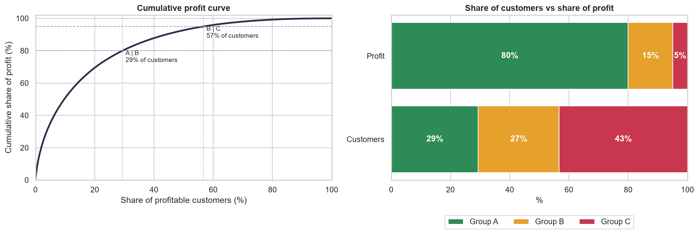
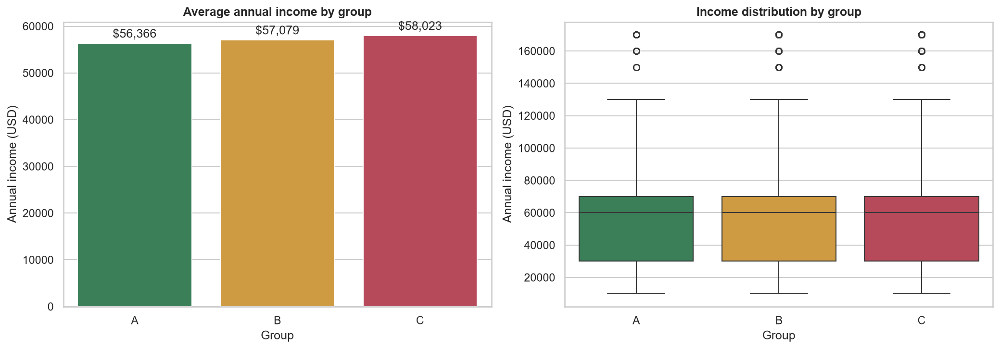

# ABC Customer Profit Analysis

[](https://github.com/Haven-Pham/abc-customer-profit-analysis/actions/workflows/ci.yml)


## Overview

A commercial team has limited account-management capacity and needs to know which customers deserve it. This
project classifies 17,415 customers of a beauty and home-care e-commerce retailer (51,290 order lines, 2020–2023) by
lifetime profit using ABC analysis, profiles each group, and quantifies a group that standard ABC charts leave out:
customers who lose money.

**Summary of results.** 29% of profitable customers (group A) generate 80% of the profit. Income and occupation are
almost identical across groups A, B and C, so demographics cannot identify high-value customers. Separately, 3,695
customers (21%) have negative lifetime profit. They destroy $267K, equal to 20% of the profit groups A–C earn, and
78% of their order lines carry discounts above 20%.



## Business Questions

1. How concentrated is profit across customers?
2. Who are the A, B and C customers, and do income or occupation set them apart?
3. How should the business treat each group, including customers who lose money?

## Approach

- **Key checks before joining.** Two product codes and one region code in the sales table had a tripled prefix
  (`PPP000002`, `RRR0001`). They were corrected so that no sales line was dropped by the join.
- **Profit by customer.** Lifetime profit is summed per customer. Customers with negative totals are set aside and
  analysed separately, because they cannot sit on a cumulative-share curve.
- **ABC thresholds.** A = the first 80% of cumulative profit, B = the next 15%, C = the last 5%.
- **Profiling.** Income and occupation are compared across groups, and discount depth is compared for loss-making
  customers.

## Key Findings

| Group | Customers | Share of customers | Profit | Share of profit | Average profit |
|---|---:|---:|---:|---:|---:|
| A | 4,031 | 29.4% | $1,065,941 | 80.0% | $264 |
| B | 3,752 | 27.3% | $199,869 | 15.0% | $53 |
| C | 5,937 | 43.3% | $66,623 | 5.0% | $11 |
| Loss-making | 3,695 | 21.2% of all customers | −$267,019 | – | −$72 |

- **Demographics do not separate the groups.** Median income is $60,000 in every group, and the occupation mix
  differs by at most two percentage points.
- **Discounting drives losses.** 78% of loss-making customers' order lines are discounted by more than 20%, against
  22% across all customers.



## Recommendations

| Group | Action |
|---|---|
| A | Dedicated account management, loyalty rewards and early access; monthly churn monitoring |
| B | Cross-sell and volume incentives to move customers toward A |
| C | Low-cost, automated service; no expensive retention offers |
| Loss-making | Tighten discount eligibility and set minimum order values; stop acquiring this profile through deep discounts |

## Deliverables

| File | Description |
|---|---|
| [`notebooks/abc_customer_profit_analysis.ipynb`](notebooks/abc_customer_profit_analysis.ipynb) | Complete analysis with outputs |
| [`reports/ABC_Customer_Profit_Results.xlsx`](reports/ABC_Customer_Profit_Results.xlsx) | Excel workbook: summary sheet with key findings, plus group summary and the full customer list with lifetime profit and group |
| [`reports/tables/customer_abc_classification.csv`](reports/tables/customer_abc_classification.csv) | Customer-level list, ready to load into a CRM or account plan |
| [`reports/figures/`](reports/figures), [`reports/tables/`](reports/tables) | Charts (PNG) and result tables (CSV) |

## Repository Structure

```text
abc-customer-profit-analysis/
├── data/                    EcomSales, Product, Customer, Region tables and data dictionary
├── notebooks/               abc_customer_profit_analysis.ipynb (analysis with outputs)
├── reports/
│   ├── ABC_Customer_Profit_Results.xlsx  (Excel results workbook)
│   ├── figures/             concentration, income and occupation charts
│   └── tables/              ABC group summary and customer list (CSV)
├── scripts/                 run_notebook.py, build_excel_report.py
└── requirements.txt
```

## Reproducing the Analysis

```bash
pip install -r requirements.txt
python scripts/run_notebook.py        # re-run the analysis, refresh figures and tables
python scripts/build_excel_report.py  # rebuild the Excel workbook
```

## Data

Synthetic, educational e-commerce data; they do not describe a real company or real customers. The published
customer table keeps only ID, gender, income and occupation. Field definitions are in [`data/README.md`](data/README.md).

## Limitations

- Because the data are synthetic, the findings illustrate the method.
- ABC uses lifetime profit and ignores recency. RFM would show which A customers are still active.
- Only income, occupation and gender are available to profile the groups. Behavioural variables would be needed to
  predict group membership.

## Author

Pham Hong Hieu (Haven) · [Portfolio](https://haven-portfolio02.vercel.app) · [LinkedIn](https://www.linkedin.com/in/havenpham) · [GitHub](https://github.com/Haven-Pham)
